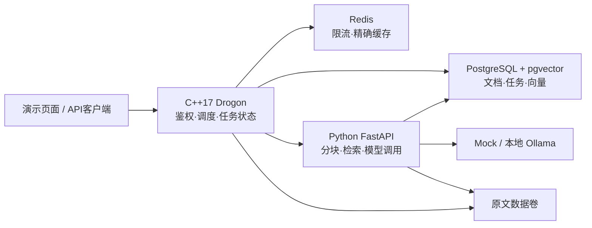

# 架构与开发约束

## 模块所有权

- C++ 写文档状态、任务状态、集合版本；Python 仅写片段和向量。
- 原文按生成的文档 ID 保存，用户文件名只作元数据。Python 再验证路径、SHA-256、格式和体积。
- Redis 不是任务持久化来源。任务存 PostgreSQL，进程中只保留容量受限的调度状态。
- 后端进程只运行一个实例；水平扩容前必须设计跨进程租约和容量协调。

## 正常请求链路

上传：校验与预留容量 → 文件 I/O 线程保存 → 原子写文档/入库任务 → 返回 202 → 异步调用 Worker → 原子入库 → 文档 ready、任务成功、集合版本增加。

问答：鉴权与校验 → Redis 原子限流 → 检查文档状态及向量签名 → 生成精确缓存键 → 命中或预留容量 → 持久任务 → 异步检索/生成 → 保存结果 → 可选缓存。

每个任务的总截止时间包含排队。调用超时和数据库最终状态以任务 ID 为准，迟到回调不能再次把已失败任务标为成功。Python 在写入事务内锁任务再锁文档，与 C++ 故障处理使用一致顺序。

## 需要能解释的设计

1. 长时间模型计算不在 C++ HTTP 事件循环执行，文件操作也在专门线程。
2. 问答和入库各自拥有 FIFO、执行上限及等待容量。预留包含尚未完成写入任务表的请求，避免多个并发提交突破各自容量。模型推理服务和数据库仍由两类任务共用。
3. 恢复查询的排除集合是快照。结果返回时再次检查当前 pending/loaded ID 与各队列的剩余容量，仅为实际入队的任务预留名额。余下任务留在数据库中等待下一轮恢复。
4. 队列任务按类型恢复 FIFO。旧 running 任务失败，半成品片段清理。
5. 缓存键包含精确问题、文档集合、集合版本和模型配置。不同检索模型的向量通过签名隔离。
6. 模型只能引用实际送入模型的片段编号。任务结果的 `evidence_trace` 记录入模、裁剪和模型声明的引用编号，引用是否支持生成结论仍需人工评测。

## 故障演练

- 关闭 Worker：新的模型任务应失败；其他轻量接口仍响应。
- 停止 Redis：新问答返回 503，不能绕过限流静默成功。
- 停止 PostgreSQL：操作反馈存储不可用；存活检查仍区分依赖就绪检查。
- 模型延迟大于截止时间：任务失败，迟到入库不能发布半成品。
- 后端重启：ready 文档保留，queued 任务恢复，running 任务明确失败。
- 模型签名改变：返回 409，重新上传同一内容触发索引重建。

所有故障测试只针对本地演示/专门测试实例，保留日志和命令。具体测试覆盖与未覆盖项见 `reports/verification.md`。
